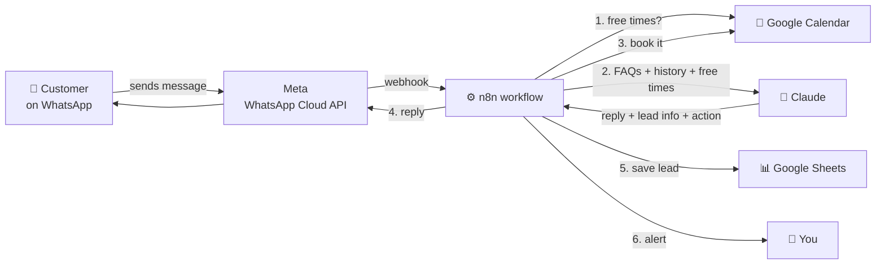
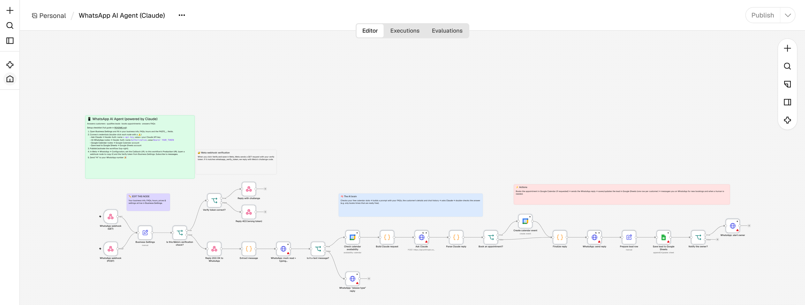

# 📱 WhatsApp AI Agent: WhatsApp Cloud API + n8n + Claude

A beginner-friendly AI assistant that chats with your customers on WhatsApp, 24/7.

| It can… | How |
|---|---|
| 💬 **Answer customers** | Friendly, short replies in the customer's own language |
| ❓ **Answer FAQs** | Uses only the FAQs, prices and info *you* write, and never makes things up |
| 🎯 **Qualify leads** | Learns name, service, timeline and budget in conversation, scores each lead **hot / warm / cold**, and saves everything to a Google Sheet |
| 📅 **Book appointments** | Offers real free times from your Google Calendar and books the one the customer confirms |
| 🙋 **Call a human** | Alerts you on WhatsApp when a customer is upset, asks for a person, or asks something it can't answer |

Example chat:

> **Customer:** Hi, how much is teeth cleaning?
> **Bot:** Hi! 😊 Scaling & polishing is Rs. 5,000 and takes 30 minutes. Would you like to book a visit?
> **Customer:** Yes, tomorrow afternoon if possible
> **Bot:** Tomorrow (Tue 24 Nov) I have *2:00 PM*, *3:30 PM* or *4:00 PM*. Which suits you, and may I have your name?
> **Customer:** 3:30, I'm Ali
> **Bot:** Shall I book *cleaning* for *Ali* on *Tuesday 24 November at 3:30 PM*?
> **Customer:** Yes please
> **Bot:** Done! ✅ You're booked for Tuesday 24 November at 3:30 PM. See you then!

…and you get: a calendar event, a row in your leads sheet (`Ali · Cleaning · hot · Tue 24 Nov 3:30 PM`) and a WhatsApp alert saying "📅 New booking".

---

## 🧭 How it works



1. A customer messages your WhatsApp Business number.
2. Meta forwards the message to your **n8n** workflow (a "webhook").
3. n8n checks your **Google Calendar** for free appointment slots.
4. n8n sends **Claude** your business info and FAQs, the free slots, what it knows about this customer, and the recent chat.
5. Claude answers with: the reply text, updated lead details, and an action (`none`, `book_appointment` or `handoff_to_human`).
6. n8n double-checks the answer (e.g. it only books times that are really free), books the appointment, sends the WhatsApp reply, updates the lead in **Google Sheets**, and alerts you when needed.

### ✅ What's already done for you

- The complete n8n workflow, [`n8n-workflow.json`](n8n-workflow.json), with notes on the canvas
- The AI instructions: answer from FAQs only, qualify leads, book safely, hand over to a human
- Sample business settings (a dental clinic) for you to replace with your own
- Memory per customer (last 20 messages), with no database to set up
- Safety checks: duplicate messages ignored, only real free slots booked, polite fallbacks if Claude, the calendar or the API has a problem
- A Google Sheet template, a test script, and a Docker setup for self-hosting
- **Tested end-to-end** in n8n 2.48 with 43 automated checks (see [For developers](#-for-developers))

### 📝 What you need to do (about 1–2 hours the first time)

The steps below need *your* accounts, so only you can do them:

| # | Step | Time |
|---|---|---|
| 1 | [Get a Claude API key](#step-1--get-a-claude-api-key) | 5 min |
| 2 | [Get n8n running](#step-2--get-n8n-running) | 10 min |
| 3 | [Create your Google Sheet and find your Calendar ID](#step-3--create-your-leads-sheet--find-your-calendar-id) | 5 min |
| 4 | [Import the workflow and fill in your business info](#step-4--import-the-workflow--fill-in-your-business-info) | 20 min |
| 5 | [Set up WhatsApp Cloud API in Meta](#step-5--set-up-whatsapp-cloud-api-meta) | 20 min |
| 6 | [Connect the credentials in n8n](#step-6--connect-the-credentials-in-n8n) | 10 min |
| 7 | [Publish and connect the webhook](#step-7--publish-the-workflow--connect-the-webhook) | 5 min |
| 8 | [Test it](#step-8--test-it-) | 10 min |
| 9 | [Go live with your real number](#step-9--go-live-with-your-real-business-number) | varies |

### 💰 What it costs

| Service | Cost |
|---|---|
| **WhatsApp Cloud API** | Replies to customers who message you are free (Meta charges for business-*initiated* template messages, which this bot doesn't send). Check [Meta's pricing page](https://developers.facebook.com/docs/whatsapp/pricing) for your country. |
| **Claude API** | Pay as you go. With the default model (`claude-opus-5-5`) a typical customer message costs roughly **1–2 US cents**. Switch to `claude-haiku-5-5` for a small fraction of that (see [Customizing](#-customizing)). |
| **n8n** | Self-hosted: free (you pay for the server). n8n Cloud: paid monthly plan with a free trial. |
| **Google Sheets / Calendar** | Free |

---

## Step 1 — Get a Claude API key

1. Go to **[platform.claude.com](https://platform.claude.com)** and sign up or log in.
2. Open **Billing** and add a payment method or some prepaid credits. $5–10 is plenty to start.
3. Open **API keys** → **Create key** → name it `whatsapp-agent` → **copy the key** (it starts with `sk-ant-`).
   You'll only see it once, so paste it somewhere safe for now.

> 🔒 Treat this key like a password. Don't paste it into chats or commit it to GitHub.

## Step 2 — Get n8n running

WhatsApp must be able to reach n8n over the internet (a public **https://** address). Pick one option:

**Option A: n8n Cloud (easiest, recommended for beginners)**
1. Sign up at **[n8n.io](https://n8n.io)** (free trial).
2. You get an address like `https://yourname.app.n8n.cloud`. That's all, HTTPS is included.
   Google sign-in (Step 6) is also one click on n8n Cloud.

**Option B: Self-host on your own server (free software, more technical)**
1. Get a small Linux server (VPS) and point a subdomain (e.g. `n8n.yourbusiness.com`) at it.
2. Install Docker, copy the [`self-hosting/`](self-hosting/) folder to the server, then:
   ```bash
   cd self-hosting
   cp .env.example .env      # then edit .env: your domain, time zone, a random key
   docker compose up -d
   ```
3. Open `https://n8n.yourbusiness.com` and create your account.
4. For Google sign-in on a self-hosted n8n you'll need to create a Google OAuth app once. Follow [n8n's Google credentials guide](https://docs.n8n.io/integrations/builtin/credentials/google/oauth-single-service/).

## Step 3 — Create your leads sheet & find your Calendar ID

**Leads sheet**
1. Go to [sheets.new](https://sheets.new) to create a new Google Sheet and name it e.g. *WhatsApp Leads*.
2. **File → Import → Upload** → choose [`google-sheet-template.csv`](google-sheet-template.csv) → *Import location: Replace current sheet* → **Import data**.
3. Rename the tab at the bottom to exactly **`Leads`** (right-click → Rename).
4. Copy the sheet's address from your browser's address bar. You'll paste it in Step 4.

**Calendar ID**
- For your main Google Calendar, the ID is simply **your Gmail address** (e.g. `drsmith@gmail.com`).
- For a separate calendar: Google Calendar → ⚙️ Settings → click the calendar on the left → *Integrate calendar* → **Calendar ID** (looks like `abc123@group.calendar.google.com`).

> 💡 Tip: create a separate calendar called "WhatsApp bookings" so bot bookings are easy to spot. The bot treats every event in the chosen calendar that's marked *Busy* as unavailable, so block out holidays and breaks there too.

## Step 4 — Import the workflow & fill in your business info

1. Download [`n8n-workflow.json`](n8n-workflow.json) (open it on GitHub → **Download raw file**).
2. In n8n: **Create workflow** → click the **⋯** menu next to the workflow name (top left) → **Import** → **From file** → choose `n8n-workflow.json`. *(Older n8n versions: ⋯ menu top right → Import from File…)*
   You'll see the whole workflow, with coloured notes explaining each part:

   

   Small red ⚠️ triangles mark the nodes that still need a credential. You'll connect those in Step 6.
3. Double-click the **Business Settings** node. It's the only node you need to edit. Fill in:

| Field | What to put |
|---|---|
| `business_name` | Your business name |
| `assistant_name` | The assistant's name, e.g. *Sara* |
| `business_description` | 2–4 sentences: what you do, address, phone |
| `services` | Your services with prices and duration, one per line |
| `business_hours` | Format: `mon-fri=09:00-17:00; sat=10:00-14:00; sun=closed`. Lunch break: `mon-fri=09:00-13:00,14:00-18:00` |
| `timezone` | e.g. `Asia/Karachi`, `Asia/Dubai`, `Europe/London` ([list](https://en.wikipedia.org/wiki/List_of_tz_database_time_zones)) |
| `appointment_length_minutes` | e.g. `30` |
| `booking_days_ahead` | How far ahead people can book, e.g. `14` |
| `min_notice_hours` | Minimum notice before a booking, e.g. `2` |
| `faq` | Your FAQs as `Q: … A: …`, one per line. **The more complete, the better the bot.** |
| `lead_questions` | What the bot should find out about each lead |
| `lead_scoring_rules` | What *hot / warm / cold* means for your business |
| `extra_rules` | Anything else, e.g. "Never give medical advice", "Don't offer discounts" |
| `owner_whatsapp_number` | **Your** WhatsApp number for alerts, international format, e.g. `923001234567` |
| `google_calendar_id` | From Step 3 |
| `google_sheet_url` | From Step 3 |
| `whatsapp_verify_token` | Make up any secret phrase, e.g. `blue-elephant-7731`. You'll paste the same phrase in Meta (Step 7). |
| `whatsapp_phone_number_id` | Optional. Leave empty, or paste your Phone number ID from Step 5 to ignore other numbers. |
| `graph_api_version` | Leave as `v26.0` |
| `claude_model` / `claude_effort` | Leave as `claude-opus-5-5` / `low` (see [Customizing](#-customizing)) |
| `fallback_reply`, `unsupported_message_reply`, `slot_unavailable_reply`, `booking_failed_reply` | Fixed messages for special cases. Translate them if your customers don't write in English. |

4. Click **Save** (top right).

## Step 5 — Set up WhatsApp Cloud API (Meta)

You need a free **Meta developer account** and a **Meta business portfolio** (Business Manager). Meta's screens change from time to time; if a button has a slightly different name, look for the closest match.

1. Go to **[developers.facebook.com](https://developers.facebook.com)** → log in with Facebook → **My Apps** → **Create App**.
2. Choose the use case **Connect with customers through WhatsApp** (or app type *Business*), give it a name, select or create your business portfolio, and finish.
3. In the left menu open **WhatsApp → API Setup** (sometimes called *Quickstart* or *Getting started*). Here you'll find:
   - a free **test phone number** that Meta gives you
   - the **Phone number ID** (copy it)
   - a **Generate access token** button
4. In the **To** field, click **Manage phone number list** and **add your own WhatsApp number**. Enter the code WhatsApp sends you. *(While you use the test number, the bot can only message numbers on this list, with up to 5 numbers.)*
5. Click **Generate access token** and copy it. ⚠️ This token **expires after about 24 hours**. That's fine for testing; Step 9 shows how to get a permanent one.
6. Optional sanity check: click **Send message** on that page. You should receive a "Hello World" WhatsApp message.

## Step 6 — Connect the credentials in n8n

Double-click each node marked with a red ⚠️ triangle and choose or create a credential (at the top of the node panel). You create each credential **once** and then reuse it in the other nodes.

| Node(s) | Credential type | Settings |
|---|---|---|
| **Ask Claude** | **Header Auth** | Name: `x-api-key` · Value: your Claude key (`sk-ant-…`). Rename the credential to *Claude API key*. |
| **WhatsApp: mark read + typing…**, **WhatsApp: "please type" reply**, **WhatsApp: send reply**, **WhatsApp: alert owner** | **Header Auth** | Name: `Authorization` · Value: `Bearer ` + your Meta token (e.g. `Bearer EAAG…`, with a space after *Bearer*). Rename it to *WhatsApp token*. |
| **Check calendar availability**, **Create calendar event** | **Google Calendar OAuth2** | Click **Sign in with Google** and allow access |
| **Save lead to Google Sheets** | **Google Sheets OAuth2** | Click **Sign in with Google** and allow access |

> ⚠️ The two Header Auth credentials are different: the Claude one goes **only** on *Ask Claude*, and the WhatsApp one on the four *WhatsApp:* nodes.

Click **Save**.

## Step 7 — Publish the workflow & connect the webhook

1. In n8n, click **Publish** (top right; older n8n versions have an *Active* toggle instead).
2. Double-click the **WhatsApp webhook (POST)** node → click **Production URL** → copy it.
   It looks like `https://yourname.app.n8n.cloud/webhook/whatsapp`.
3. Back in Meta: **WhatsApp → Configuration** → **Webhook** → **Edit**:
   - **Callback URL:** paste the Production URL
   - **Verify token:** the `whatsapp_verify_token` phrase from Business Settings
   - Click **Verify and save**. A ✅ means n8n answered Meta correctly.
4. Still on that page, under **Webhook fields**, find **messages** and click **Subscribe**.

> If verification fails: is the workflow **published**? Did you use the **Production** URL (not the Test URL)? Does the token match exactly, with no extra spaces?

## Step 8 — Test it 🎉

1. From your phone (the number you added in Step 5), send **"Hi"** to the Meta test number.
2. Within a few seconds you should see "typing…" and then a reply.
3. Try a full conversation: ask a FAQ, ask for prices, then ask to book an appointment.
4. Check that:
   - n8n → **Executions** shows green runs (click one to see each step)
   - your **Leads** sheet has a row for your number
   - after booking, the event is in your Google Calendar and you got a "📅 New booking" WhatsApp alert

You can also send a test message without your phone, from a terminal:
```bash
./scripts/send-test-message.sh https://yourname.app.n8n.cloud/webhook/whatsapp 923001234567 "What are your opening hours?" YOUR_PHONE_NUMBER_ID
```

> 🧪 **Memory note:** the bot only remembers conversations in **published** (production) runs. If you click *Execute workflow* in the editor, it works but won't save memory. Always test from WhatsApp.

## Step 9 — Go live with your real business number

When you're happy with the test number:

1. **Add your real number:** Meta → WhatsApp → API Setup → **Add phone number**. Use a number that is *not* currently registered in the WhatsApp or WhatsApp Business app (or delete that account first), and follow the verification steps. Copy its new **Phone number ID**.
2. **Get a permanent token** (the test token expires daily):
   1. Go to [business.facebook.com](https://business.facebook.com) → **Settings** → **Users → System users** → **Add**. Name it `n8n-bot`, role **Admin**.
   2. **Assign assets:** give it your **app** (full control) and your **WhatsApp account** (full control).
   3. **Generate token** → choose your app → expiry **Never** → permissions **`whatsapp_business_messaging`** and **`whatsapp_business_management`** → copy the token.
   4. In n8n, edit your *WhatsApp token* credential → Value: `Bearer YOUR_NEW_TOKEN` → Save.
3. **Add a payment method** in Meta (WhatsApp → API Setup or Business settings → Payment methods).
4. **Verify your business** (Business settings → Security Center) to lift messaging limits and get your display name approved.
5. Make sure the webhook from Step 7 is still set and your workflow is published.

> ⚠️ **Owner alerts and the 24-hour rule:** WhatsApp only lets a business send normal messages to someone who messaged it in the last 24 hours. To keep getting alerts reliably, send any message to your business number from your own phone each day (the bot will answer you too, which is fine). Alerts are never lost: every handoff is also recorded in the `human_requested_at` and `handoff_reason` columns of your sheet.

---

## 🎨 Customizing

**Improve the answers.** Most of the bot's quality comes from `faq`, `services` and `extra_rules` in **Business Settings**. When the bot hands over a question it couldn't answer, add that answer to `faq`.

**Change tone or language.** Add a line to `extra_rules`, e.g. *"Use a casual, fun tone"* or *"Always reply in Urdu"*. By default the bot replies in whatever language the customer writes in.

**Choose a different Claude model.** Set `claude_model` in Business Settings:

| `claude_model` | Good for |
|---|---|
| `claude-opus-5-5` (default) | Best quality and most reliable bookings |
| `claude-sonnet-5-5` | Very good quality, about half the price |
| `claude-haiku-5-5` | Fastest and cheapest, fine for simple FAQ bots |

`claude_effort` (`low`, `medium` or `high`) controls how hard Claude thinks before answering. `low` keeps replies fast; try `medium` if bookings or answers aren't accurate enough.

**Change what's saved about leads.** Edit the **Prepare lead row** node. Each field there is a column in your sheet; if you add a field, add a column with the same name to the sheet.

**Turn off something you don't need:**
- No Google Calendar or bookings: right-click **Check calendar availability** and **Create calendar event** → **Deactivate** (or select the node and press **D**). The bot will then pass booking requests to you.
- No Google Sheets: deactivate **Save lead to Google Sheets**.
- No owner alerts: leave `owner_whatsapp_number` as it is.

## 🛠️ Troubleshooting

| Problem | What to check |
|---|---|
| Meta says it **couldn't validate the callback URL** | Workflow published? Production URL (not Test URL)? Same verify token in Meta and Business Settings? |
| **No executions** appear in n8n when you message the bot | In Meta → WhatsApp → Configuration, is the **messages** field subscribed? Are you messaging the right number? While on the test number, is your number in the allowed **To** list? |
| Executions run but **no reply arrives** | Open the execution → click **WhatsApp: send reply** → look at the output. `401`/`190` errors mean the token is expired or wrong (re-generate it, Step 5 or Step 9). `131030` means the recipient isn't in the allowed list. |
| Bot replies *"I'm having a little trouble…"* every time | Open an execution → **Parse Claude reply** → the `problem` field says why. Usually it's a wrong Claude key, no credits, or a typo in `claude_model`. |
| Bot never offers times / says the calendar is unavailable | Check the **Check calendar availability** output. Common causes: wrong `google_calendar_id` (it must look like an email address), or the Google credential isn't connected. |
| Lead isn't saved to the sheet | The tab must be named exactly `Leads`, the first row must have the column names from the template, and the URL must be the full sheet address. |
| Bot doesn't remember earlier messages | Memory only works in published (production) runs, so test from WhatsApp rather than with *Execute workflow*. |
| Replies are **slow** (more than ~15 seconds) | Keep `claude_effort` at `low`, or try `claude-sonnet-5-5` / `claude-haiku-5-5`. Click an execution to see which step takes longest. |
| n8n won't publish: *"conflict with another webhook"* | Another published workflow already uses the `whatsapp` path. Unpublish the old one (or change the **Path** in both webhook nodes and update the URL in Meta). |

## ❓ FAQ

**Where is the conversation memory stored?** Inside the n8n workflow itself (its "static data"). It keeps the last 20 messages per customer, and forgets customers after 90 days without contact.

**Can it understand voice notes or images?** Not yet. It politely asks the customer to type instead.

**Can it reschedule or cancel bookings?** Not by itself. It hands those requests to you, so you can change the event in Google Calendar.

**Will customers know it's a bot?** If someone asks, it says honestly that it's an AI assistant. Customer messages are sent to Anthropic's Claude API to write the replies.

**Can I keep using the WhatsApp Business app on the same number?** A number connected to the Cloud API normally can't also be used in the regular WhatsApp Business app. Use a separate number for the bot, or look into Meta's "coexistence" onboarding through a Meta Business Partner.

---

## 👩‍💻 For developers

```
whatsapp-ai-agent/
├── n8n-workflow.json          ← the workflow to import (generated, don't edit by hand)
├── google-sheet-template.csv  ← header row for the Leads sheet
├── docs/workflow-in-n8n.png   ← screenshot of the imported workflow
├── scripts/send-test-message.sh
├── self-hosting/              ← docker-compose + .env for a VPS with HTTPS
├── src/
│   ├── build-workflow.mjs     ← generates n8n-workflow.json
│   └── code/*.js              ← the JavaScript inside the four Code nodes
└── test/e2e/                  ← end-to-end tests against real n8n + mock APIs
```

- **Rebuild the workflow** after editing anything in `src/`: `node src/build-workflow.mjs`
- **Run the end-to-end tests** (needs Node.js 24+, openssl and n8n installed; no accounts or keys needed):
  ```bash
  npm install -g n8n
  ./test/e2e/run.sh
  ```
  The script starts a real n8n with a throw-away database, imports the workflow, and points all outgoing HTTPS traffic at local stand-ins for Claude, WhatsApp, Google Calendar and Google Sheets. It then checks 43 behaviours across 10 scenarios: webhook verification, ignoring receipts, FAQ, lead capture, memory, booking, duplicate messages, invalid slots, handoff, API errors, refusals, non-text messages, and calendar outages.

**How Claude is called:** a plain HTTP Request node posts to `https://api.anthropic.com/v1/messages` with `anthropic-version: 2026-10-21`. Claude returns **structured JSON** (`output_config.format`) so n8n can act on it reliably. The system prompt is built only from Business Settings and marked with `cache_control`, so it can be cached across messages. Live data (date, free slots, known lead details) goes in a context block on each new message. Server-side refusal fallbacks (`fallbacks: "default"`) are turned on for Opus and Sonnet models. Chat history is replayed as plain text turns.
